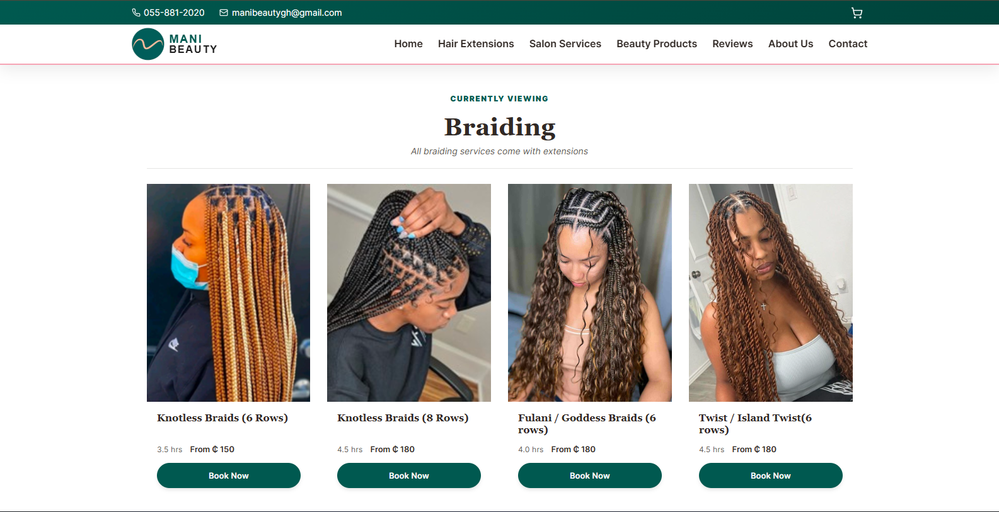
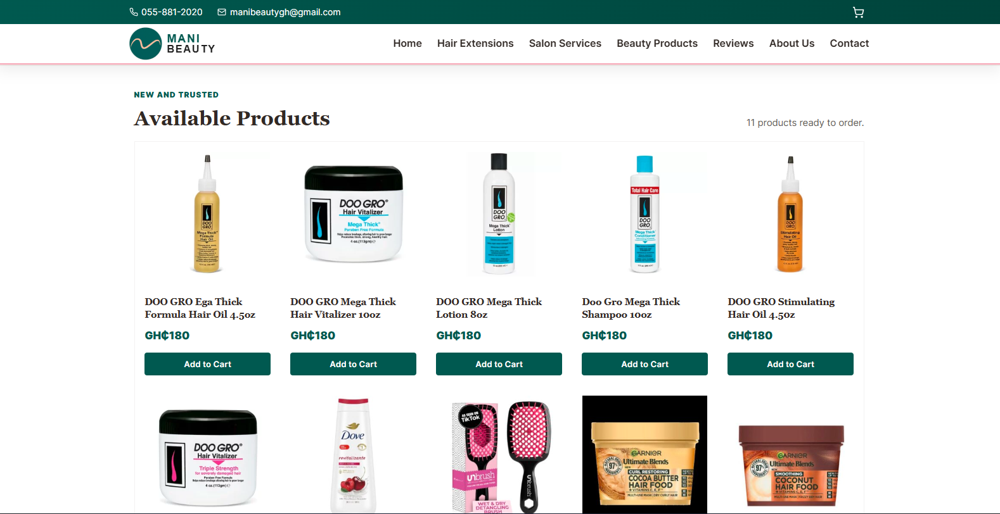
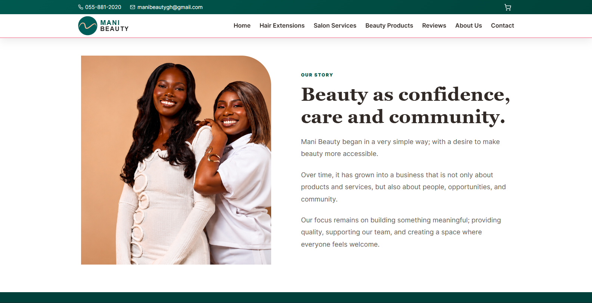
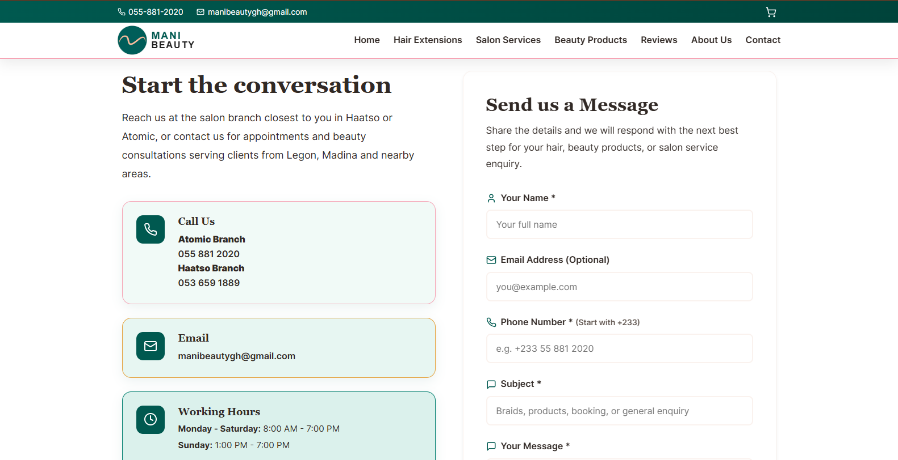

# Mani Beauty

Mani Beauty is a customer-facing beauty and salon website for clients in Accra, Ghana. It brings hair extensions, salon services, beauty products, appointment enquiries and product ordering together in one responsive experience.

**Live website:** [manibeauty.co](https://manibeauty.co)


## Project overview

The site helps customers discover the brand, browse services and products, request appointments, and contact the salon. The repository includes the frontend, API routes, admin pages, and integrations used to support those workflows.

### Customer experience

- Browse hair extensions and beauty products, with cart and checkout flows.
- Explore salon services and request a booking.
- Send a contact enquiry and read customer reviews and brand information.
- Find location information for Atomic, Haatso, Legon and Madina.
- Use responsive layouts designed for desktop and mobile.

### Operations and integrations

- Admin pages for catalog management, product orders, dashboard activity and audit logs.
- API endpoints for bookings, contact enquiries, catalog data, uploads and product orders.
- Paystack payment initialization, verification and webhook handling.
- Supabase support for data and storage, with optional email, SMS, WhatsApp and Redis integrations configured through environment variables.
- Vite static-site build and an Express API that can run locally or be packaged for AWS Lambda with AWS SAM.

## Screenshots

| Home | Hair extensions |
| --- | --- |
|  |  |

| Salon services | Beauty products |
| --- | --- |
|  |  |

| About Mani Beauty |
| --- |
|  |

| Contact |
| --- |
|  |

## Technology

- React 18 and Vite
- Express 5 API
- React Router, React Hook Form and Lucide icons
- Supabase client and SSR packages
- Paystack integration
- AWS SAM and Lambda support for backend deployment

## Getting started

### Prerequisites

- Node.js and npm
- A current copy of the repository
- Optional service credentials for the integrations you plan to use

### Install dependencies

```bash
npm install
```

### Configure local environment

Copy `.env.example` to `.env` for local application settings. For the Paystack local testing setup, follow the instructions in `.env.local.example` and copy it to `.env.local`. Fill in only the credentials required by the features you are running. The repository ignores `.env` and `.env*.local`; never commit real keys or secrets.

At minimum, the sample configuration documents these optional service groups:

- Supabase project URL, public key, service role key and database connection
- Paystack public and secret keys
- Resend email delivery settings and notification recipients
- SMS provider credentials and sender IDs
- Upstash Redis URL and token for rate limiting
- API/site URL, CORS origins and admin access settings

Keep secret keys server-side. Use Paystack test keys while developing and configure production credentials only in the hosting provider's secret manager.

### Run the application

Start the development setup (frontend and local API proxy):

```bash
npm run dev
```

The scripts also allow the client and API to be run separately in different terminals:

```bash
npm run dev:client
npm run dev:server
```

Build the static frontend and prerender SEO pages:

```bash
npm run build
```

Run the Express API in production mode:

```bash
npm start
```

The Vite development frontend is configured for `http://localhost:3000`; the API uses port `3001` by default. See `vite.config.js`, `scripts/dev.mjs` and `.env.example` for the current local proxy and port settings.

## Deployment

The repository supports more than one deployment arrangement. Review the deployment guide that matches your hosting setup before publishing:

- [Deployment guide](DEPLOYMENT.md)
- [AWS Lambda deployment](AWS-LAMBDA-DEPLOYMENT.md)

For the AWS SAM backend workflow, the package scripts are:

```bash
npm run sam:build
npm run sam:local
npm run sam:deploy
```

The static frontend build is written to `dist/`. When deploying the frontend separately from the API, configure its API base URL and allowed CORS origins for the deployed domains.

## Repository map

```text
app/                 Customer pages, admin pages and API routes
  api/               Bookings, contact, catalog, orders, payments and admin endpoints
  admin/             Admin dashboard and management pages
  booking/           Appointment request flow
  checkout/          Product checkout flow
  hair-extensions/   Hair extension collection
  products/          Beauty product catalog
  services/          Salon service listings and booking entry points
  locations/         Location index and branch pages
data/                Catalog and local data definitions
lib/                 Shared API, authentication, payment and integration helpers
public/              Static product, salon and brand imagery
scripts/             Development, migration and SEO build scripts
server/              Express API and Lambda entry point
supabase/            Database schema, policies and migrations
docs/screenshots/    README screenshots
```

## Project documentation

This repository contains additional implementation and operations notes. Useful starting points include:

- [Start here](START-HERE.md)
- [Content guide](CONTENT-GUIDE.md)
- [Project structure](PROJECT-STRUCTURE.md)
- [Deployment](DEPLOYMENT.md)
- [AWS Lambda deployment](AWS-LAMBDA-DEPLOYMENT.md)
- [Environment guide](ENVIRONMENT.md)

For supported commands and dependencies, see `package.json`. For configuration names and safe local setup, see `.env.example` and `.env.local.example`.

## Notes

The screenshot images in `docs/screenshots/` are included to illustrate the customer-facing site. Product availability, service details, prices and contact information may change; refer to the live website for current customer information.
